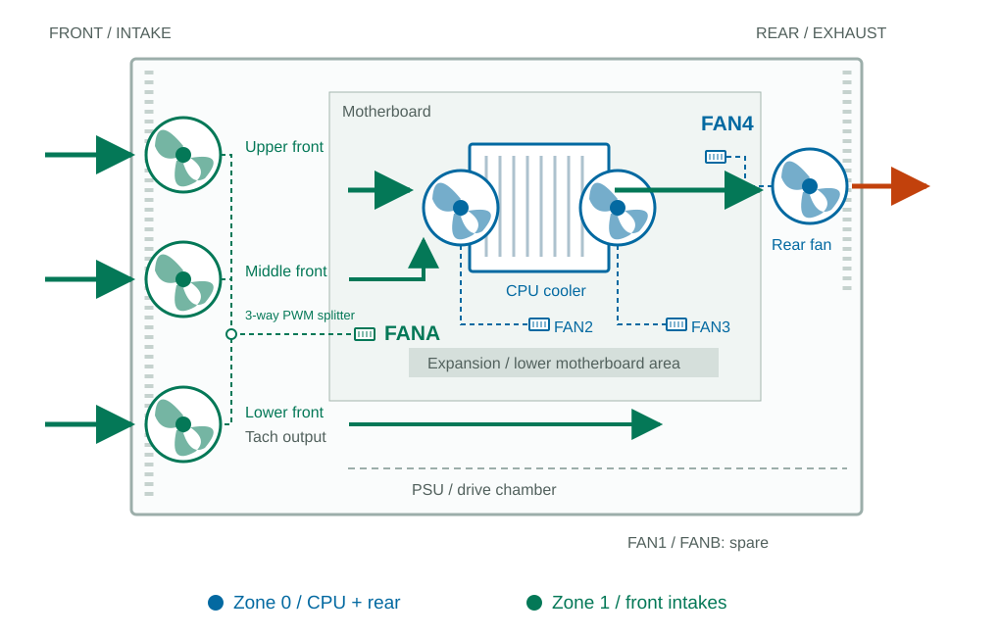

# Node2 Hardware: X12SCZ-F And LANCOOL III

## LANCOOL III RGB Fan Connections

Reference layout and node2 curve for four stock case fans and two Scythe Mugen 6
CPU fans. The lower intake is the third, lowest front-panel fan. The CPU
heatsink moves air from front to rear. Validate temperatures and noise with
the case closed before unattended use.

| Fan position | Header | PWM zone | Control |
|---|---|---|---|
| CPU heatsink, two fans | FAN2 and FAN3 | 0 | Shared CPU temperature curve |
| Rear exhaust | FAN4 | 0 | Same curve |
| Upper, middle and lower front intakes | FANA via three-way PWM splitter | 1 | Shared front-intake curve |
| Unused | FAN1 | 0 | Spare |
| Unused | FANB | 1 | Spare |

Connect all three front fans to a four-pin PWM splitter, and the splitter to
FANA. Keep the rear exhaust on FAN4 and the CPU cooler fans on FAN2/FAN3. Check the board
silkscreen against its SDR sensor names when connecting fans.

A conventional splitter returns the tachometer signal from only one fan.
Use the lower front fan on that monitored output; its tachometer wire must
reach the splitter's designated RPM-sensing input. FANA then reports its RPM,
not an average or the speeds of all three. Check the other two fans visually:
their individual failure cannot be detected through this single tachometer.
Never combine multiple tachometer outputs unless the splitter explicitly
supports it.

Check the splitter rating and the sum of fan motor currents, including startup
requirements, against the header limit. Use an externally powered PWM hub if
the load exceeds that limit. ARGB lighting connections are separate from PWM
fan motor connections.

## Airflow And PWM Zones

Zone 0 couples the CPU cooler with the rear exhaust. Zone 1 controls all three
front intakes together, supplying both the CPU area and the lower chassis.
This separates the front fans' minimum duty from the CPU cooler's minimum while
keeping rear exhaust synchronized with CPU cooling. The PSU has its own fan,
separate from these motherboard connections.

This is an engineering layout for this case, not a Supermicro-prescribed
chassis configuration. The board manual identifies FAN1 as the CPU connector;
the other fan connectors can serve system cooling. PWM zones do not specify
the physical location of a fan inside a case.

One zone sends the same PWM percentage to all its fans, **not the same RPM**.
The rear fan still shares duty with the CPU cooler fans, so its stable minimum and
alarm thresholds constrain zone 0. The three front fans share duty through the
splitter; none has independent speed control. Individual speed control within
the same zone is not available through this interface.

## Control And Safety

The supplied controller uses CPU temperature for both zones, with a separate
PWM curve for each. Zone 1 can therefore retain a quiet front-intake baseline
and increase airflow as CPU temperature rises. Moving connectors does not
change either configured curve or establish a new stable minimum.

Node2 curve:

| CPU temperature | CPU/rear, zone 0 | Front intakes, zone 1 |
|---|---:|---:|
| Up to 54 C | 50% | 50% |
| 55-75 C | 60% | 70% |
| 76-80 C | 80% | 90% |
| 81-85 C | 90% | 100% |
| 86 C and above | 100% | 100% |

At idle, the 50% minimum kept FAN2, FAN3 and FAN4 above their 700 RPM critical
thresholds. During a 90-second, 100% CPU `stress-ng` run, the 60%/70% stage held;
the highest temperature logged by the controller was 61 C. No higher stage or
new critical fan event appeared in the BMC log.

| Measured on node2 | FAN2 | FAN3 | FAN4 | FANA |
|---|---:|---:|---:|---:|
| 50%/50%, idle | 1260 RPM | 1260 RPM | 980 RPM | 700 RPM |
| 60%/70%, CPU stress | 1540 RPM | 1540 RPM | 1120 RPM | 1120 RPM |

These are observed speeds, not switching thresholds. The controller selects a
stage from CPU temperature.

The node2 host profile sets FAN4 lower-critical to **700 RPM** and lower-non-recoverable
to **420 RPM**, matching FAN2/FAN3. FAN1 thresholds and BMC hysteresis remain
unchanged. FAN4 can still report `Lower Non-Critical` while its numerical LNC
threshold is `n/a`; this status is distinct from a new critical assertion in
the BMC event log.

Keep a nonzero front-intake baseline and verify drive, system and peripheral
temperatures with the case closed. CPU temperature alone does not establish
that the lower chassis is adequately cooled.

Do not reduce CPU fan alarm thresholds to accommodate case fans. Case-fan
thresholds must preserve stop detection and reliable restart. Verify every fan
sharing a zone before using these values on another host.

Shut down and disconnect power before moving connectors. The SVG is a
functional airflow schematic, not an exact motherboard connector locator or
cable-routing guide.

## Fan Specifications

| Stock case fan | Quantity | Speed range |
|---|---|---|
| Front 140 mm ARGB PWM | 3 | 300-1650 RPM |
| Rear 140 mm PWM | 1 | 200-1800 RPM |

The CPU cooler is separate from the case and has its own speed range.

## Vendor References

- [Supermicro X12SCZ family manual, revision 1.1a](https://www.supermicro.com/manuals/motherboard/X12/MNL-2257.pdf): printed pages 11-12 for connector locations/names, page 47 for four-pin fan connections.
- [X12SCZ-F specifications](https://www.supermicro.com/en/products/motherboard/X12SCZ-F): dual cooling zones. The product page says five fan headers, whereas the family manual lists six; verify the actual board.
- [LANCOOL III specifications and manual](https://lian-li.com/product/lancool-iii/): stock fan positions and speed ranges.
- [Supermicro fan-group explanation for X9SCL-F](https://www.supermicro.com/en/support/faqs/faq.php?faq=13433): background on numbered/peripheral groups, not a specification of X12 firmware's automatic sensor policy.
